# 000 — Tidy Mac Master Architecture & Implementation Plan

- **Author**: Tidy Mac Senior Engineering Team
- **Status**: Reviewed & Approved (Phase 1 Critique Completed)
- **Target OS**: macOS 14.0+ (Sonoma, Sequoia, and beyond)
- **Technology Stack**: Swift 6, SwiftUI, Swift Concurrency (Actors, AsyncStream), SwiftData/GRDB, Keychain Services, SMAppService.
- **Reference Skills**: Compound Engineering (`ce-plan`, `ce-doc-review`, `ce-work`, `ce-code-review`, `ce-compound`).

---

## 1. Executive Summary & Product Vision

**Tidy Mac** is an AI-powered native Mac cleaner and file organizer engineered for effortless storage optimization and workspace tidiness. It combines high-speed, local file intelligence with an offline-capable natural language cleanup agent and an AI folder organization engine. 

### Core Product Tenets
1. **Zero Data Loss**: Every cleanup operation moves items exclusively to the macOS Trash (`FileManager.default.trashItem`). Permanent deletion is forbidden in the cleanup pipeline.
2. **Defensive Isolation**: Hard-coded path denylists and symlink canonicalization prevent accidental modification of system, developer, and personal identity files.
3. **Privacy by Design**: All file operations, duplicate detection, and scanning occur 100% locally on device. AI interactions use a strictly isolated `MetadataOnly` contract—file contents are never accessed or transmitted.
4. **Resilient Offline Utility**: A deterministic heuristic engine handles common natural language cleaning commands without an internet connection or API key.
5. **Reversible Actions**: A transactional `UndoJournal` logs all operations with exact restore paths and metadata for single-click reversal.

---

## 2. Review Findings & Safety Hardening (Phase 1 Critique)

During the Phase 1 critique pass, several critical edge cases and attack vectors were evaluated and incorporated into the design:

1. **Symlink Traversal Prevention**:
   - Directory enumerators (`FileManager.DirectoryEnumerationOptions`) must enforce `.skipsPackageDescendants` and explicitly disable following directory symlinks.
   - Any single-file symlink must be canonicalized with `URL.resolvingSymlinksInPath()`. If the target falls into a protected denylist path, it is strictly rejected.
2. **Cloud Storage & Evicted Dataless Faults (iCloud, Dropbox, OneDrive)**:
   - Dataless cloud files (`NSURLUbiquitousItemDownloadingStatusNotDownloaded`) must not be read or hashed, preventing unwanted network downloads and storage thrashing.
   - Warn user when items to be cleaned reside in synced cloud directories.
3. **APFS Hard Link De-duplication**:
   - Inode deduplication (`stat.st_ino` / `fileResourceIdentifierKey`) ensures hard-linked files are not falsely flagged as duplicate files or double-counted in storage metrics.
4. **Comprehensive User Identity Denylist**:
   - The denylist explicitly encompasses critical user identity configurations: `~/.ssh`, `~/.gnupg`, `~/.aws`, `~/.zshrc`, `~/.bashrc`, `~/.gitconfig`, `~/.config`, as well as `.git` repository internals.
5. **Safe Restoration & Collision Handling**:
   - In `UndoJournal` restoration, if a file of the same name was created at the original path while the file was in Trash, the restorer appends a non-destructive counter suffix (`name (restored 1).ext`).
   - If Trash was emptied externally, report `UndoError.fileNoLongerInTrash` gracefully.
6. **Large File Streaming Cryptography**:
   - SHA-256 calculation uses chunked streaming (64 KB buffers via `FileHandle` and `CryptoKit.SHA256`) to ensure O(1) memory footprint even on 50 GB+ files.
7. **High-Volume UI Virtualization**:
   - Scanner events stream via `AsyncStream` and batch UI state updates on `@MainActor` at 100ms throttle intervals to prevent beachballs when indexing 500,000+ files.

---

## 3. System Architecture & Data Flow

### 3.1 Architecture Overview

```mermaid
flowchart TD
    subgraph UI ["SwiftUI Application Layer (@MainActor)"]
        Sidebar["Sidebar Navigation"]
        Dashboard["Overview Dashboard"]
        CleanupUI["Cleanup & Risk Preview"]
        DupUI["Duplicate Finder"]
        AppUI["App Uninstaller"]
        AgentUI["NL Agent & Dry-Run"]
        OrgUI["AI Organizer"]
        RulesUI["Custom Rules"]
        HistoryUI["Undo Journal UI"]
        SettingsUI["Settings & Privacy"]
        MenuBar["MenuBarExtra Monitor"]
    end

    subgraph Core ["TidyMacCore Engine Layer (Swift 6 Actors)"]
        FileAccess["FileAccess Actor\n(Sandbox & FDA Guard)"]
        PathVal["PathValidator & Denylist\n(Canonicalization & Traversal Defense)"]
        Scanner["StorageScanner Actor\n(Parallel AsyncStream Enumeration)"]
        RiskEval["RiskEvaluator\n(Safe / Review / Manual)"]
        DupEngine["DuplicateEngine\n(Size -> Partial Hash -> SHA-256)"]
        UninstallEngine["UninstallEngine\n(BundleID Leftovers Discovery)"]
        RuleEngine["RuleEngine\n(Built-in & User Triggers)"]
        AgentPlanner["AgentPlanner\n(Offline Heuristic & Schema Validator)"]
        Organizer["FolderOrganizer\n(Collision-Safe Directory Synthesis)"]
        UndoJournal["UndoJournal Actor\n(Atomic Operation Journaling)"]
        Scheduler["ScheduleCoordinator\n(SMAppService / Background Timer)"]
        LLM["LLMClient Actor\n(Anthropic & OpenAI Providers)"]
    end

    subgraph OS ["macOS System Services"]
        TCC["TCC & Security-Scoped Bookmarks"]
        Trash["macOS Trash System"]
        Keychain["macOS Keychain Services"]
        Notifications["UNUserNotificationCenter"]
        DiskArbitration["APFS & Volume Statistics"]
    end

    %% Wiring
    UI --> Core
    Scanner --> PathVal
    Scanner --> FileAccess
    Scanner --> RiskEval
    DupEngine --> FileAccess
    DupEngine --> PathVal
    UninstallEngine --> FileAccess
    RuleEngine --> Scanner
    AgentPlanner --> LLM
    AgentPlanner --> PathVal
    Organizer --> PathVal
    CleanupUI --> UndoJournal
    UndoJournal --> Trash
    Scheduler --> Notifications
    FileAccess --> TCC
    LLM --> Keychain
    Dashboard --> DiskArbitration
```

---

## 4. Core Engine Modules & Interfaces

### 4.1 Safety & Permissions
- **`PathValidator`**:
  - Enforces canonicalization and denies traversal.
  - Denylist covers:
    - Root system paths: `/System`, `/Library`, `/usr`, `/bin`, `/sbin`, `/private`, `/etc`, `/var`, `/opt`
    - Core apps: `/Applications/Utilities`, `/Applications/Safari.app`, `/System/Applications`
    - Home root: `~`
    - Developer internals: `**/.git`, `**/.svn`, `**/.hg`
    - User identity & secrets: `~/.ssh`, `~/.gnupg`, `~/.aws`, `~/.config`, `~/Library/Keychains`, `~/Library/IdentityServices`, `~/Library/Mail`
    - Personal databases: `~/Pictures/*.photoslibrary`
- **`FileAccessService`**:
  - Manages Security-Scoped Bookmarks (`startAccessingSecurityScopedResource` / `stopAccessingSecurityScopedResource`).
  - Detects Full Disk Access via test read of protected directory (`~/Library/Safari`).
  - Provides deep-link to `x-apple.systempreferences:com.apple.preference.security?Privacy_AllFiles`.
- **`TrashMover`**:
  - Encapsulates `FileManager.trashItem(at:resultingItemURL:)`.
  - Clears `UF_IMMUTABLE` lock flags safely if user requests trashing of locked files.
  - Never executes `removeItem` or `unlink`.

### 4.2 Storage Scanner & Risk Evaluator
- **`StorageScanner`**:
  - Concurrent `AsyncStream` traversal.
  - Groups: Caches, Logs, Developer (DerivedData, Simulator runtimes), Old Downloads (.dmg/.pkg/.zip > N days), Screenshots, Large Files (> threshold, inactive), Trash, App Leftovers, Messaging/Browser media.
- **`RiskEvaluator`**:
  - **`Safe`**: Ephemeral caches, system logs, verified downloaded installers (> 7 days), emptyable Trash items. Pre-selected by default.
  - **`Review`**: User documents, old screenshots, large archive files, inactive app support directories. Requires user review.
  - **`Manual`**: Critical configuration files, protected bundle contents, items requiring explicit manual Finder intervention. Permanently non-selectable in the UI.

### 4.3 Duplicate Finder Engine
- **Three-Tier Pipeline**:
  1. File size grouping (`fileSize`).
  2. Partial 32 KB SHA-256 hash (16 KB head + 16 KB tail).
  3. Full cryptographic SHA-256 hash.
- **Safety Invariant**: In any duplicate group, the engine pre-selects suggested duplicates to trash (defaulting to newest or longest path), but **strictly validates that at least one original copy remains unchecked**.
- Skips packages, symlinks, and dataless cloud files.

### 4.4 App Uninstaller Engine
- Scans `/Applications` and `~/Applications`.
- Refuses system apps and protected apps.
- Identifies leftover files across:
  - `~/Library/Application Support/<bundleId|name>`
  - `~/Library/Caches/<bundleId|name>`
  - `~/Library/Preferences/<bundleId>.plist`
  - `~/Library/Containers/<bundleId>`
  - `~/Library/Logs/<bundleId|name>`
  - `~/Library/Saved Application State/<bundleId>.savedState`
  - `~/Library/HTTPStorages/<bundleId>`
- Bundles app and all leftovers into a single transactional trashing batch.

### 4.5 Natural-Language Agent Planner & AI Organizer
- **`OfflineHeuristicParser`**: Local regex and token parser extracting age, size, category, and target folders without network or API key.
- **`LLMClient`**: Protocol supporting Anthropic Claude and OpenAI with keys stored in macOS Keychain.
- **`MetadataOnlyPayload`**: Strictly isolates file metadata (relative path, extension, size, dates) and ensures zero file content is sent.
- **`CleaningPlanSchema`**: Typed JSON schema for structured cleaning plans.
- **`FolderOrganizer`**: Generates collision-free folder hierarchy proposals (`file (1).ext`) with before/after diff previews.

### 4.6 Undo Journal & Persistence
- **`UndoJournal`**: Records batch ID, timestamp, original URL, trashed URL, file size, and checksum.
- Reverses actions atomically. Restores missing parent directories if needed.

### 4.7 Scheduler & Continuous Cleanup
- Runs daily, weekly, monthly, or on low disk space triggers (< 10GB).
- Uses `SMAppService.agent` or `launchd` LaunchAgent daemon.
- Only executes previously approved user rules.
- Dispatches macOS user notifications summarizing reclaimed space.

---

## 5. Detailed Task Breakdown & Implementation Roadmap

The implementation is broken into 12 small, independently shippable tasks. Each task includes strict acceptance criteria and an automated test plan.

### Task 1: Project Skeleton, Localization, & Core Models
- **Scope**:
  - `Package.swift` with `TidyMacCore` library, `TidyMacApp` executable target, and `TidyMacTests` test target.
  - Localization String Catalog architecture covering 8 languages (en, fr, de, ja, ko, zh-Hans, zh-Hant, es) and `LocalizationManager`.
  - Core data models: `FileItem`, `RiskLabel`, `ScanCategory`, `CleaningAction`, `JournalEntry`, `StorageSummary`.
- **Acceptance Criteria**: `swift build` and `swift test` succeed with zero warnings.
- **Test Plan**: Unit test verifying localization key lookups and data model encoding/decoding.

### Task 2: PathValidator, Protected Denylist, & TrashMover
- **Scope**:
  - `PathValidator` with canonicalization, symlink bounds checking, and hard-coded denylist.
  - `TrashMover` encapsulating `FileManager.trashItem` with immutable flag clearing.
- **Acceptance Criteria**: Denies `/System`, `~`, `~/.ssh`, `..` traversals, and symlink targets outside allowed roots.
- **Test Plan**: `SafetyTests` with automated path-traversal and denylist penetration tests.

### Task 3: FileAccessService & Permissions Manager
- **Scope**:
  - `FileAccessService` actor managing security-scoped bookmarks and Full Disk Access detection.
  - `CloudFolderDetector` identifying iCloud, Dropbox, OneDrive, and checking eviction status.
- **Acceptance Criteria**: Generates and resolves security-scoped bookmark data; detects cloud folders.
- **Test Plan**: `FileAccessTests` with fixture folders and mock bookmark storage.

### Task 4: StorageScanner & RiskEvaluator
- **Scope**:
  - `StorageScanner` concurrent actor with `AsyncStream` reporting progress.
  - Category classifiers for Caches, Logs, Developer (DerivedData), Installers, Screenshots, Large Files, Trash, App Leftovers.
  - `RiskEvaluator` assigning `Safe`, `Review`, `Manual`.
- **Acceptance Criteria**: Scans directory tree, groups into categories, flags risks properly.
- **Test Plan**: `ScannerTests` against a seeded fixture directory verifying expected categories and risk ratings.

### Task 5: Overview Dashboard & Space Preview UI
- **Scope**:
  - SwiftUI Dashboard with disk usage bar (Used, Free, Reclaimable).
  - Category breakdown view with live counters and lifetime space reclaimed.
  - Space preview component calculating current free, selected cleanup, and projected free space.
- **Acceptance Criteria**: UI compiles and reflects simulated scan results dynamically.
- **Test Plan**: SwiftUI View snapshot / state unit tests.

### Task 6: UndoJournal & Cleanup Execution Engine
- **Scope**:
  - `UndoJournal` actor with persistent log storage.
  - Atomic cleanup execution using `TrashMover` and journal logging.
  - Single-click restore action with collision handling.
- **Acceptance Criteria**: Trashing moves files to Trash; Undo restores them to original path.
- **Test Plan**: `UndoJournalTests` verifying end-to-end trashing and byte-for-byte file restoration.

### Task 7: DuplicateFinderEngine & Duplicate UI
- **Scope**:
  - 3-tier pipeline: size grouping $\rightarrow$ partial 32KB hash $\rightarrow$ full SHA-256 hash.
  - Safe auto-selection algorithm (oldest or shortest path, never selecting all copies).
  - Duplicate groups view with comparison and keep-one guarantee.
- **Acceptance Criteria**: Accurately detects duplicates and guarantees $\ge 1$ copy preserved.
- **Test Plan**: `DuplicateTests` with identical, partial-match, and distinct files.

### Task 8: AppUninstallerEngine & Leftovers Scanner
- **Scope**:
  - Application bundle discovery in `/Applications` and `~/Applications`.
  - Protected system app filter.
  - Leftover scanner searching `Application Support`, `Caches`, `Preferences`, `Containers`, `Logs`.
- **Acceptance Criteria**: Finds installed apps, protects system apps, locates bundle ID leftovers.
- **Test Plan**: `UninstallerTests` with simulated app bundle and fake leftover trees.

### Task 9: Natural-Language Agent Planner & Dry-Run Preview
- **Scope**:
  - `OfflineHeuristicParser` for offline natural language parsing.
  - `LLMClient` protocol with Anthropic and OpenAI implementations.
  - Keychain service for API key storage.
  - `MetadataOnlyPayload` boundary enforcement.
  - `CleaningPlanSchema` JSON validation.
  - Interactive dry-run preview UI.
- **Acceptance Criteria**: Offline parser produces valid plan schema; LLM interface rejects file content; Dry run requires explicit confirmation.
- **Test Plan**: `AgentPlannerTests` verifying regex parsing, schema validation, and metadata-only boundaries.

### Task 10: AI Folder Organizer & Collision-Free Moves
- **Scope**:
  - `FolderOrganizer` synthesizing taxonomy from file extensions and dates.
  - Collision-safe renamer appending `(1)` on conflicts.
  - Before/after tree preview.
- **Acceptance Criteria**: Proposes valid folder structure and prevents file overwrite.
- **Test Plan**: `OrganizerTests` verifying proposal generation and collision-safe renaming.

### Task 11: RuleEngine & ScheduleCoordinator
- **Scope**:
  - 10 built-in rule templates + user-defined rules.
  - `ScheduleCoordinator` for background continuous cleanup.
  - Notification integration via `UNUserNotificationCenter`.
- **Acceptance Criteria**: Rules trigger correctly against matching files; background scheduler dispatches notifications.
- **Test Plan**: `RuleEngineTests` and `SchedulerTests`.

### Task 12: MenuBarExtra, Licensing Stub, & Final End-to-End Integration
- **Scope**:
  - `MenuBarExtra` quick-status monitor.
  - `LicenseProvider` protocol with free tier (2GB) + 15-day trial stub.
  - Settings, Privacy statement screen, and in-app language switcher.
  - Comprehensive end-to-end integration test against realistic fixture home directory.
  - Release build verification.
- **Acceptance Criteria**: Complete test suite passes; release binary builds; fixture cleanup and undo round-trip succeeds.
- **Test Plan**: `EndToEndFixtureTests` running complete workflow.

---

## 6. Acceptance Criteria Checklist

- [ ] `swift build` and `xcodebuild` build the app with zero errors.
- [ ] Full automated test suite passes with 100% success rate.
- [ ] Path-traversal and denylist penetration tests pass.
- [ ] On a fixture folder, junk is found, moved to Trash, and Undo restores it exactly.
- [ ] Duplicate finder never selects all copies in any group.
- [ ] Manual-risk items cannot be selected or cleaned.
- [ ] Space preview dynamically matches real post-cleanup results.
- [ ] All 8 languages supported with in-app language picker.
- [ ] Natural-language agent works offline with no API key.
- [ ] Scheduled background run operates headless with notification.
- [ ] Protected path denylist cannot be bypassed.
- [ ] Metadata-only boundary verified by automated test.
- [ ] `README.md` documents build, permissions, and usage.
- [ ] `docs/solutions/` and `AGENTS.md` record lessons learned.
