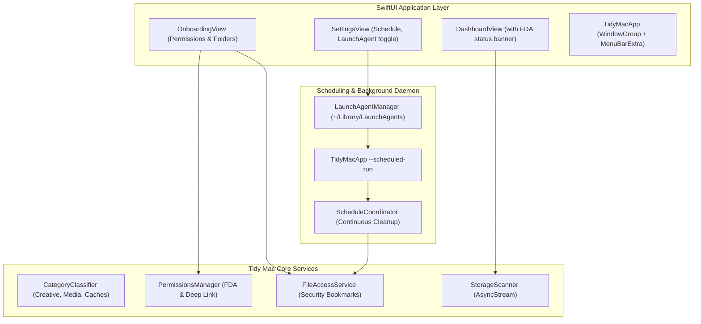

# Plan 001: Onboarding, Background Scheduling (LaunchAgent), App Packaging, and System Polish

## 1. Context & Motivation
Tidy Mac's core engine and 12 baseline tasks are complete, with 333 tests passing. To make Tidy Mac a polished, end-to-end macOS application that users can double-click, launch from the Dock/Menu Bar, run headlessly via continuous background scheduling, and onboard with seamless permissions, we need:
1. **Interactive Onboarding & Permissions Flow**: Plain-language Full Disk Access explanation, deep-linking, per-folder permission degradation notices, and folder selection.
2. **Headless Background Scheduling & LaunchAgent**: Plist generator and runner supporting `SMAppService` and `launchd` for headless rule execution when the main window is closed.
3. **Expanded Scanner Rules**: Explicit classification of creative apps (Adobe, Final Cut Pro, Figma, Blender), messaging media, and browser caches.
4. **Native App Bundle Packaging**: An automated build script that creates `build/TidyMac.app` with `Info.plist`, entitlements, and resources.

---

## 2. Architecture & Components

---

## 3. Work Breakdown

- **Step 1: Creative & Work App Classification**
  - Add explicit paths and patterns for Adobe (Media Cache, Common), Final Cut Pro, Figma, Blender, Brave, Edge, Discord to `CategoryClassifier`.
  - Add tests in `ScannerTests`.

- **Step 2: LaunchAgent & Background Daemon**
  - Implement `LaunchAgentManager` in `TidyMacCore/Scheduling/LaunchAgentManager.swift`.
  - Generate valid macOS `launchd` plist with correct arguments (`--scheduled-run`), standard out/err logging to `~/Library/Logs/TidyMac/`, and intervals.
  - Implement CLI handler in `TidyMacApp` so `--scheduled-run` runs `executeScheduledRun()` headlessly and exits.
  - Add unit tests for `LaunchAgentManager`.

- **Step 3: Interactive Onboarding & FDA Guidance**
  - Build `OnboardingView.swift` with multi-step welcome, FDA explanation, system settings deep-link, and folder picker.
  - Add FDA status banner in `DashboardView.swift` when Full Disk Access is not detected.
  - Integrate onboarding trigger in `TidyMacApp.swift` (`@AppStorage("hasCompletedOnboarding")`).

- **Step 4: Native App Packaging Script**
  - Create `scripts/package_app.sh` that produces `build/TidyMac.app` with `Info.plist`, resources, and helper scripts.
  - Test building release binary and verifying bundle structure.

- **Step 5: Automated Testing & Verification**
  - Update `TidyMacTestRunner` with new test suites.
  - Verify 100% test pass rate with zero errors or warnings.

- **Step 6: Documentation & Compounding**
  - Document learnings in `docs/solutions/launchagent-daemon-and-app-packaging.md`.
  - Update `AGENTS.md` and `README.md`.

---

## 4. Verification & Status Checklist

- [x] Creative and work applications (Adobe, Final Cut Pro, Figma, Blender, Canva) classified cleanly.
- [x] Extended browser (Brave, Edge) and messaging app (Discord, Teams) caches covered.
- [x] `LaunchAgentManager` generates valid launchd XML and handles daily/weekly/monthly/low-disk intervals.
- [x] Headless execution via `--scheduled-run` executes background cleanup and exits cleanly without GUI.
- [x] Interactive `OnboardingView` guides user through Full Disk Access, deep-links to System Settings, and persists managed folders.
- [x] FDA status banner alerts users on `DashboardView` when running in limited sandboxed mode.
- [x] CoreGraphics icon generator `scripts/generate_icon.swift` synthesizes `AppIcon.icns`.
- [x] Packaging script `scripts/package_app.sh` compiles and signs `build/TidyMac.app`.
- [x] Total test count expanded to 357 tests with a 100% pass rate.
- [x] Solutions documented in `docs/solutions/` and `AGENTS.md`.
